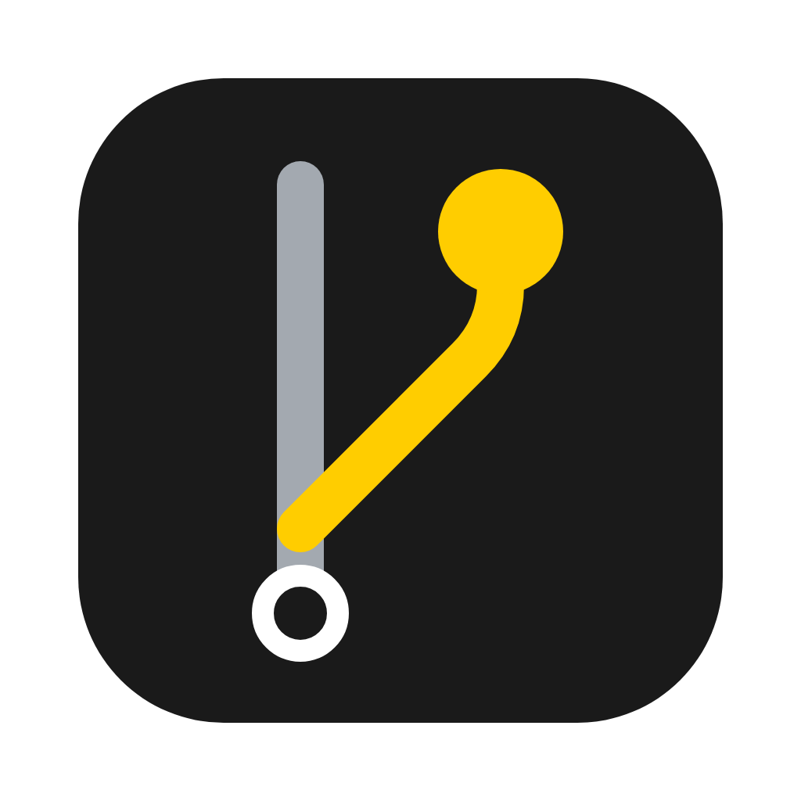
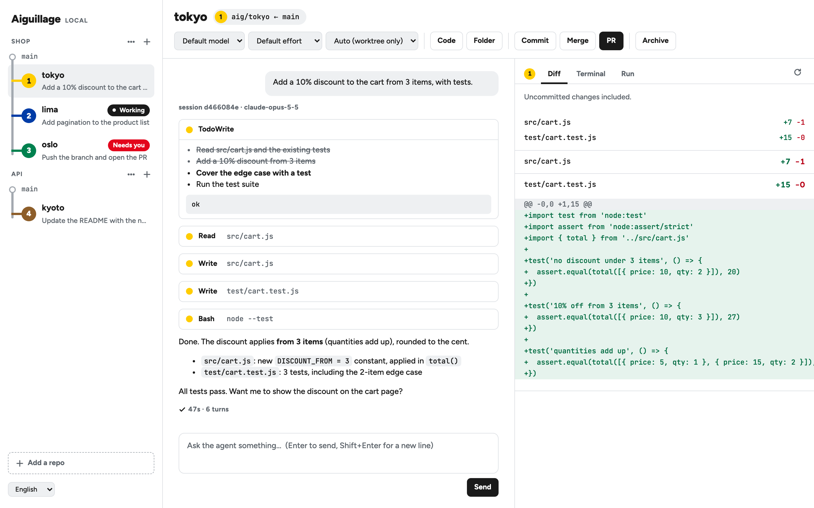
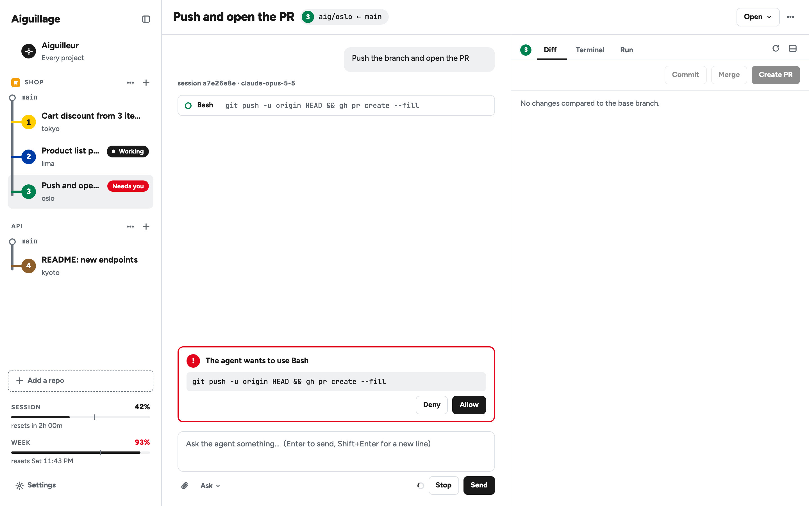
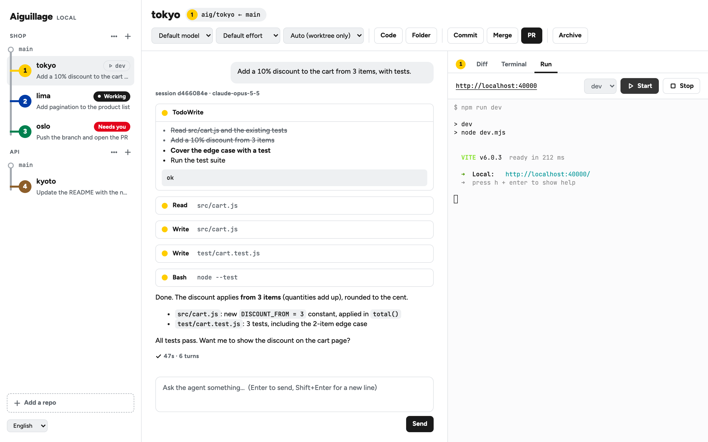
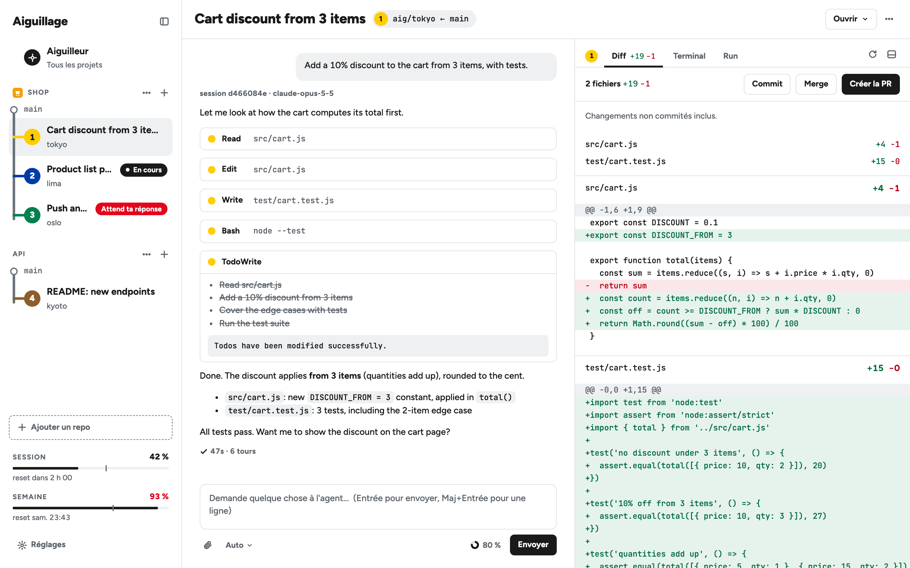

<div align="center">



# Aiguillage

**Run several Claude Code agents in parallel, each on its own branch, from a single window.**
100% local: no account, no cloud, no telemetry.

[](LICENSE)
[](https://nodejs.org)
[](#install)
[](#tests)
[](#languages)
[](CONTRIBUTING.md)

[Install](#install) · [Features](#features) · [Configuration](#per-repo-configuration) · [Languages](#languages) · [Contributing](CONTRIBUTING.md)

<br>

<picture>
  <source media="(prefers-color-scheme: dark)" srcset="docs/screenshots/hero-dark.png">
  
</picture>

</div>

## Why Aiguillage

One agent per isolated branch, five agents at a time: Aiguillage gives you that workflow without an account or a remote service.

- **It drives your own `claude` CLI.** Your subscription, models, MCP servers, hooks and skills stay yours. Aiguillage doesn't reimplement Claude Code and doesn't call the API.
- **Every agent works in its own git worktree**, on an `aig/<name>` branch. Your main checkout is never touched.
- **Everything stays on your machine.** The server only listens on `127.0.0.1`, and nothing is loaded from a CDN.

*Aiguillage* is French for a railway switch: the lever that sends each train down its own track.

## Install

**Requirements:** Node ≥ 22, git, and the [Claude Code CLI](https://docs.claude.com/en/docs/claude-code), already logged in (`claude` on your `PATH`). [`gh`](https://cli.github.com) is optional (for the PR button).

Never used a terminal? Open the `.dmg` app: on first launch it checks git, Claude Code and your Claude login, and installs each missing one in one click.

```bash
git clone https://github.com/xeewi/aiguillage.git
cd aiguillage
npm install
```

Then pick one:

```bash
npm start      # in your browser → http://127.0.0.1:4317
npm run app    # in a macOS app window (Electron)
npm run dist   # builds dist/Aiguillage-<version>-arm64.dmg
```

> [!NOTE]
> The app and the browser share port 4317: if one is already running, the other connects to it instead of starting a second server. `PORT=xxxx` changes the port; `--no-open` skips opening the browser.
>
> The `.dmg` isn't signed by Apple yet: on first launch, right-click → **Open**.

### Updates

The app checks [GitHub releases](https://github.com/xeewi/aiguillage/releases) at launch and every 4 hours, downloads a new version in the background and offers **Restart to update** in the sidebar (or *Aiguillage → Check for Updates…*). It comes back on the same workspace and tab, with conversations and running scripts; an update left pending installs when you quit. This check is the app's only network request of its own: turn it off in **Settings**. If the app isn't in a folder it can write to (still on the `.dmg`, in Downloads), it offers the download instead.

To publish a version: bump `version` in `package.json`, commit, then `git tag v0.2.0 && git push --tags`. The [release workflow](.github/workflows/release.yml) builds the `.dmg` and the `.zip` the updater downloads, and publishes the release.

## How it works

1. **Add a local repo** (or a plain folder, turned into one), then click `+`: a worktree and its `aig/<city>` branch are created from `origin/<base>`, and your `setup` script runs. Claude names the workspace from your first message; double-click to rename it.
2. **Talk to the agent.** Replies stream in, with tool calls and todos shown as they happen. Attach files, use any `/` command. You can interrupt at any time.
3. **Review the diff, test in the terminal** or with your Run scripts.
4. **Open a PR** (via `gh`) or **merge locally**, then **archive** the workspace.

Meanwhile, the other workspaces keep going. A colored badge shows each one's state: *working*, *needs you*, *finished*.

## Features

<table>
<tr>
<td width="50%" valign="top">

### Permissions and plans

Four modes per workspace:

- **Auto**: everything is approved, except file edits outside the worktree, which are refused.
- **Ask**: you approve every tool call.
- **Auto edits**: file edits go through, everything else asks you.
- **Plan**: you approve the agent's plan, or reject it with a comment.

Model (every CLI alias: Fable, Opus, Sonnet, Haiku, the 1M variants, Opus Plan) and thinking effort are also set per workspace, under the message box. **Settings** holds the defaults for new workspaces.

</td>
<td width="50%"></td>
</tr>
<tr>
<td width="50%"></td>
<td width="50%" valign="top">

### Terminal and Run scripts

A real shell in the worktree, plus a **Run** tab with your named scripts. Each workspace gets its own ports, so five dev servers can run side by side without clashing.

The agent knows its worktree, its ports and the Run script's log file, which it can read to debug.

</td>
</tr>
</table>

| | |
|---|---|
| **Chat** | One `claude` process per workspace (stream-json): streaming, tool calls and todos, nested subagents, Stop button. Sessions resume with `--resume`. The composer shows the context left until auto-compact. |
| **Slash commands** | Every Claude Code command, skill and plugin command in a `/` menu (`/clear`, `/model`…); full-screen ones open in the terminal. |
| **Attachments and media** | Drop files anywhere on the window, paste them, or use the paperclip (up to 100 MB each). Images, videos and sounds the agent embeds by local path play in the thread; click an image to see it full size. |
| **Background work** | Running subagents and background shells are listed above the composer, each with its own Stop. |
| **Checkpoints** | ↺ on any of your messages rolls back the files **and** the conversation to just before it. |
| **Diff** | Everything that changed since the base branch: commits, modified files, new files, uncommitted changes included. |
| **Shipping** | Commit, local merge into the base branch, PR via `gh`, archive (worktree removed, branch kept and restorable). |
| **Ignored files** | Files listed in `.worktreeinclude` (else `file_include_globs`, else `.env*`) are copied into every new worktree. |
| **Sidebar** | Each repo with its logo, its workspaces and their state; right-click a workspace to open, rename, copy its branch or path, mark it unread, stop or archive it. Your plan usage (session and week limits) at the bottom, live. Collapsible, with a resizable split. |
| **Notifications** | System notification when an agent finishes or needs you. <kbd>⌘</kbd><kbd>1</kbd>…<kbd>9</kbd> switches workspaces, <kbd>⇧</kbd><kbd>⌘</kbd><kbd>A</kbd> archives the open one. |
| **Settings** | Theme (System / Light / Dark), language, defaults for new workspaces, how many agents work at once, repos, updates, Telegram, and your measures. |
| **Agents at work at once** | Past the number set in **Settings** (5 by default), or once your plan's session is at 90 %, a message that would start one more agent waits in a queue (🕒, kept across restarts) and goes out as soon as one finishes or usage drops. From the window, you're asked first: send anyway, or queue it (a message behind others already waiting just joins them). Queued messages show over the composer, why and since when, each with **Cancel**; archiving a workspace drops its queue, and a report lists what was dropped. A message to an agent already working always goes through. |
| **Watchdog** | An agent silent for 10 minutes, repeating the same tool call three times, or on a turn of over an hour is reported ⏸ to the aiguilleur. It is never stopped: you decide. |
| **Overlaps** | Two workspaces of a repo changing the same files are reported (⚠️) as soon as it happens, not at merge time: merging both may conflict. After a merge, the workspaces that changed some of the merged files are told to rebase, with their next message. |
| **Measures** | Kept on your Mac only: cost per workspace and for the aiguilleur, turns, merges and conflicts, checks, how long permission requests wait, Telegram messages per day. **Settings** shows the last 14 days. |
| **Aiguilleur** | One agent above all workspaces: reports on them and relays your instructions, with a memory of each project. See [Aiguilleur](#aiguilleur). |
| **Telegram** | Away from the Mac: the same conversation with the aiguilleur, which passes on the agents' reports and your answers. See [Remote control](#remote-control-telegram). |

## Aiguilleur

**Aiguilleur** (French for the switchman who sets the points), at the top of the sidebar, is a Claude Code agent of its own that sees every repo and workspace. It reports and relays, it never decides: ask it where things stand or to read a diff, and tell it what to pass on to which agent (or to start a task in a new workspace); it sends your instruction as you gave it and does nothing you didn't ask for. It acts through Aiguillage's local API and leaves the code to the workspaces' agents.

It is your one interlocutor: when an agent finishes a turn, its report lands in the aiguilleur's conversation, and a click on it opens the workspace. Every agent ends its turn with a short report block (status, what it checked, what it didn't, what it needs from you), so a report reads ✅ done, ⏸ waiting on you (blocked, or a decision to take) or ❌ failed, with the project / workspace, its last words, and the facts Aiguillage checked itself: the [check](#per-repo-configuration)'s verdict (and its output when red), the test files the turn changed (agents are told to stop and ask rather than bend a test to pass; `test_globs` in `settings.toml` says what a test file is). The aiguilleur reads the reports it hasn't seen yet at the top of your next message, so it knows where things stand without being woken for each one.

What it may do, through Aiguillage's API: read the state, a workspace's conversation and diff, relay your message to an agent (or interrupt it), rename a workspace, run a check. For a new task, it hands the agent a **brief** built from your own words (goal, scope, done criteria, what to escalate), which you approve in one click; the brief stays visible on the workspace. **What can't be undone waits for your click**, in the window or on Telegram: creating a workspace (the confirmation shows its final name, and its base when it isn't the repo's), commit, merge, PR, archive, delete; the outcome comes back as a report. A request still waiting survives a restart (one over a day old is dropped, and a report says so); when you asked from Telegram, its buttons go there even out of remote mode. Everything else is yours alone, and the API refuses it to the aiguilleur: answering a permission request, an agent's model, effort or permission mode, revert, scripts, Settings, Telegram.

It runs in `~/.aiguillage/aiguilleur`, outside every repo, in Auto mode, and that folder is its memory, the only place it writes: `CLAUDE.md` (loaded at each session: your standing preferences and one line per project) and `projects/<repo>.md` (purpose, stack, how to run it, work in progress, your decisions), built the first time it needs a project and kept up to date. After each agent turn, a quick Haiku call adds what's worth keeping (done, decided, in progress, blocked) to the end of that project's file, under `## Journal`, dated, with the workspace's name; the aiguilleur folds it into the rest when it reads the notes. They're plain Markdown: read or edit them yourself. One conversation, the same in the window and on [Telegram](#remote-control-telegram).

## Remote control (Telegram)

Leave the Mac running at home and keep the loop going from your phone. Off until you set it up:

1. In Telegram, ask [@BotFather](https://t.me/BotFather) for a new bot (`/newbot`) and copy its token.
2. In Aiguillage, **Settings → Telegram**: paste the token, **Connect**.
3. **Open in Telegram**, then tap **Start**: that one-time link ties your chat to the bot (on the phone, send it the `/start …` command shown instead). Only that chat is obeyed; **Disconnect** turns it all off.

**Remote mode** decides when Telegram is pushed anything: the switch at the bottom of the sidebar, or `/remote` and `/local` from Telegram. Turning it on (it is on right after linking) catches you up: where every workspace stands, each agent's report missed meanwhile, the requests still waiting. Off, nothing comes on its own, but you can still write to the aiguilleur from there and get its answers.

In remote mode:

- **A live board is pinned at the top of the chat**: the counts first (🔐 waiting for you, ⏳ working, 🕒 queued, ❌ failed, 💤 idle), always in sight in the pinned bar, then your plan's session and week usage (with when they reset, 🔴 from 90 %), then each repo once with its workspaces by their short title: what one waits for, or what it is doing (its last tool call) and for how long; the idle ones share a line. It is edited in place, silently, as the agents work. `/status` posts it again at the bottom, in either mode; out of remote mode it stops updating.
- **The whole conversation with the [aiguilleur](#aiguilleur)** comes to Telegram: each agent's report when its turn ends, what you type to it at the Mac (🖥), its answers. What you write on Telegram shows in the window too (📱). Telegram renders their Markdown (bold, lists, code, tables), as rich messages; one it refuses goes as plain text.
- **Only what needs you comes at once**: a failure, a question (⏸), a red check, a change to test files, an overlap, a stuck agent, the outcome of something you confirmed. Finished work waits and comes as one digest at 9:00, 13:00 and 18:00 (local time), or when you send `/digest`. **Settings → Telegram → Reports** switches to "push every report". Waiting reports are kept across restarts.
- **Everything you write goes to the aiguilleur**, which relays. **Reply** to a report to answer that agent: the aiguilleur knows which one and passes it on; reply `/stop` to interrupt it.
- **Photos, albums, documents, videos, voice notes** go with it, as attachments in its conversation; it passes them on to the agent they're for, which gets its own copy. Telegram lets a bot fetch 20 MB at most: a bigger file is refused with a message. A voice note: the aiguilleur transcribes it when a tool for that is installed (`whisper-cli` and a model), otherwise it tells you it can't listen to it.
- **And back: the screenshots, videos and sounds** an agent shows in its report (or the aiguilleur in its answer, `` as in the chat) come after the text as photos, videos or files, a 📎 with their caption in their place. Reply to one to answer that agent. Up to 50 MB each; a photo Telegram refuses (too big, too thin) comes as a file.
- **Permission requests, plans and what the aiguilleur asks to do** (merge, commit…) arrive with Allow / Deny buttons.

Nothing listens on the network: Aiguillage polls Telegram. In remote mode, the Mac doesn't go to sleep on its own (`caffeinate`), but closing the lid still does. Turning remote mode on from Telegram gives that chat nothing it couldn't already do: once linked, it can always talk to the aiguilleur. Anyone who controls your Telegram account can drive your agents, and the aiguilleur can run commands on the Mac: keep your account protected (two-step verification).

## Per-repo configuration

Aiguillage reads these files, highest priority first:

1. `<repo>/.aiguillage/settings.local.toml`: your own overrides (add it to `.gitignore`)
2. `<repo>/.aiguillage/settings.toml`: shared with the team
3. `~/.aiguillage/settings.toml`: defaults for all your repos
4. otherwise: `aiguillage.json`

No run script anywhere? Aiguillage guesses from the project files and lists every match in the Run tab, the first one being the default: `Makefile` / `justfile` targets `dev` `start` `run` `serve`, `package.json` and `deno.json` scripts (with your lockfile's package manager), `Procfile` `web:`, then `cargo run`, `go run .`, Django `manage.py runserver`, `main.py` / `app.py`, `bin/rails server`, `mix phx.server`, `swift run`, Gradle, Maven, `dotnet run`, `docker compose up`. `$PORT` is set to the workspace port.
Nothing recognized? **Ask the agent** in the Run tab: it works out the command and writes `.aiguillage/settings.toml` for you.

```toml
test_globs = ["**/*.test.*", "e2e/**"]  # optional: what counts as a test file (a turn that changes one says so)

[scripts]
setup = "pnpm install"
check = "pnpm test"          # verification gate, see below
run_mode = "concurrent"      # "nonconcurrent": only one workspace of the repo runs its script at a time

[scripts.run.dev]
command = "pnpm dev --port $AIGUILLAGE_PORT"
default = true

[scripts.run.test]
command = "pnpm test --watch"
```

**`check`**: a command that verifies the work (tests, lint, build), run in the worktree through your login shell (10 minutes at most, `AIGUILLAGE_CHECK_TIMEOUT_MS` to change). It runs the agent's changes whatever the workspace's permission mode, so it is read from the main checkout's settings (and `~/.aiguillage/settings.toml`), never from the worktree's own `settings.toml`, which the agent could edit. It runs by itself when an agent's turn ended and the files (or the `check` command itself) differ from the last check; the result (and, when red, the end of its output) comes with the agent's report, and 🧪❌ marks the workspace on the Telegram board. The Diff tab shows the verdict and a **Run check** button. Merging asks for confirmation when the check is red or out of date (when the aiguilleur asks, the confirmation says the check isn't green, and your click then merges anyway). No `check`, or a free session: nothing runs and merge is unchanged.

<details>
<summary>JSON format</summary>

```json
{ "setup": "npm install", "run": "npm run dev -- --port $AIGUILLAGE_PORT", "archive": "" }
```

</details>

<details>
<summary>Environment variables for scripts, the terminal and the agent</summary>

| Variable | Value |
|---|---|
| `AIGUILLAGE_ROOT_PATH` | path of the main repo |
| `AIGUILLAGE_WORKSPACE_NAME` | workspace name (`tokyo`, `lima`…) |
| `AIGUILLAGE_WORKSPACE_ID` | internal id |
| `AIGUILLAGE_WORKSPACE_PATH` | path of the worktree |
| `AIGUILLAGE_DEFAULT_BRANCH` | base branch |
| `AIGUILLAGE_IS_LOCAL` | always `1` |
| `AIGUILLAGE_PORT` | first of the 10 ports reserved for the workspace |

</details>

## Languages

The interface follows your browser or system language, and you can switch it in **Settings**. English and French ship today.

<details>
<summary>Screenshot in French</summary>



</details>

Translations use [i18next](https://www.i18next.com). Adding a language means adding one JSON file, no code: see [Adding a language](CONTRIBUTING.md#adding-a-language).

## Data and privacy

- Everything lives in `~/.aiguillage/` (`state.json`, `logs/`, `worktrees/`, and `metrics.jsonl`, the [measures](#features), never sent anywhere). Set `AIGUILLAGE_HOME` to move it.
- Aiguillage's API answers only its own window and the aiguilleur (a secret token only the aiguilleur's process gets): any other caller, an agent's `curl` or a script of yours, is refused (401). Drive it from the window.
- Checkpoints are private git refs, `refs/aiguillage/*`, in your repo.
- Only the `claude` CLI talks to the network, exactly as when you use it directly, plus the [update check](#updates), which you can turn off. Once you turn [Telegram](#remote-control-telegram) on, the reports and what you send go through Telegram too. Its bot token is kept in `state.json`. API keys are stripped from the agent's environment, so usage is billed to your Claude account.

## Architecture

Node and vanilla JavaScript, no build step. You can read the whole codebase in an evening.

```
server.js          HTTP + WebSocket + terminals (node-pty)
lib/agent.js       claude process, permissions, briefing, watchdog
lib/remote.js      Telegram bridge and aiguilleur
lib/report.js      the report block agents end each turn with
lib/review.js      check, test files touched, overlaps
lib/brief.js       the aiguilleur's task briefs
lib/metrics.js     local measures (metrics.jsonl)
lib/git.js         worktrees, diff, checkpoints
lib/config.js      per-repo settings (TOML / JSON)
lib/i18n.js        server-side messages (i18next)
lib/update.js      self-update from GitHub releases
lib/store.js       persisted state
public/            UI (index.html, app.js, i18n.js, theme.js, style.css)
public/locales/    translations, one JSON file per language
electron/main.js   macOS app window
```

More: [docs/DNA.md](docs/DNA.md) (project principles, in French) and [DESIGN.md](DESIGN.md) (visual system).

## Tests

```bash
npm test           # unit + integration (223 tests, ~25 s)
npm run test:e2e   # browser flows, Playwright (57 tests, ~30 s)
npm run test:all   # both
```

The tests never call the real Claude. `test/fake-claude.mjs` mimics the CLI (same stream-json protocol, permission requests, resumed and rewound sessions), and Aiguillage uses it through `AIGUILLAGE_CLAUDE`. Each test file starts its own isolated server.

## Contributing

Issues and pull requests are welcome. Read [CONTRIBUTING.md](CONTRIBUTING.md) first.

## Disclaimer

Aiguillage is an independent project, not affiliated with Anthropic.

## License

[MIT](LICENSE) © Guillaume Gautier
