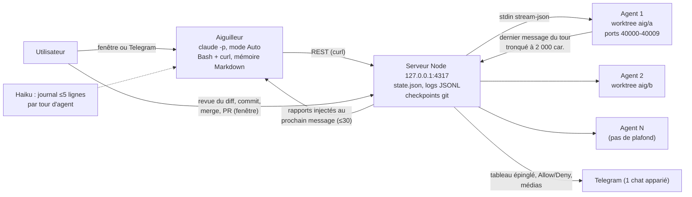
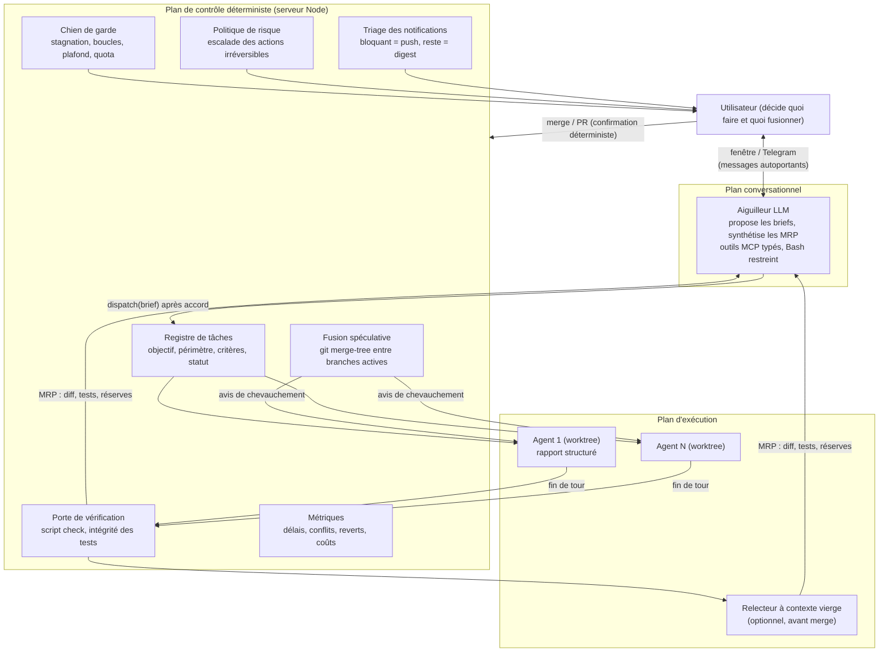

# Muscler l'aiguilleur : vérifier avant de relayer

Le pattern construit avec Aiguillage se théorise comme un **orchestrateur-travailleurs centralisé dont le vrai manager est l'humain et dont le LLM central joue le rôle de standardiste** : un plan de contrôle déterministe (le serveur Node) isole chaque agent Claude Code dans son worktree git, et un agent conversationnel unique, l'aiguilleur, traduit les intentions de l'utilisateur en appels d'API et lui remonte les rapports, dans l'app comme sur Telegram. Ce choix est solide sur trois points que la recherche et l'industrie valident : l'isolation par worktree (le standard local du marché), un seul saut de relais sans reformulation (la cause des « erreurs de traduction » des superviseurs), et un hub peu coûteux qui ne se réveille pas à chaque événement. Mais en l'état, l'exécution relève de la topologie « indépendante » de Kim et al., celle qui amplifie le plus les erreurs (**17,2×** contre **4,4×** pour une topologie centralisée qui valide), et toute la validation repose sur l'humain, dont la capacité de revue est le goulot démontré (temps de revue des PR **+91 %** dans les équipes très outillées en IA). La littérature indique trois leviers qui ne demandent pas de rendre l'aiguilleur décideur : **vérifier mécaniquement** dans le plan déterministe (tests, intégrité des tests, fusion spéculative entre branches), **structurer les échanges** (brief de dispatch avec critères d'acceptation, rapport de fin de tour au format « prêt à fusionner »), et **protéger l'attention humaine** (ne pousser sur Telegram que ce qui bloque, escalader seulement les actions irréversibles, environ **0,8 %** des actions). Le plan d'action en fin de rapport commence par instrumenter le système, car Aiguillage ne dispose aujourd'hui d'aucune donnée d'usage pour savoir s'il accélère réellement son utilisateur.

## Un orchestrateur-travailleurs où l'humain décide et le LLM aiguille

### Ce qu'est le système, mécaniquement

Aiguillage fait tourner un serveur HTTP et WebSocket local sur le port 4317, qui pilote un processus `claude -p` persistant par « workspace », chacun dans un worktree git sur une branche `aig/<nom>`, en dialoguant en stream-json sur stdin et stdout ([lib/agent.js:133-149](../lib/agent.js)). L'aiguilleur n'a rien de spécial techniquement : c'est **la même fonction `start()` que n'importe quel travailleur**, distinguée seulement par un prompt système ajouté, un répertoire de travail hors de tout dépôt qui lui sert de mémoire, le mode Auto, et un emballage côté serveur qui préfixe chaque message utilisateur des rapports non lus ([lib/remote.js:534-542](../lib/remote.js)). Il n'a **aucun outil dédié** : il agit par `curl` sur la même API REST que l'interface, sans serveur MCP propre ([lib/agent.js:135-148](../lib/agent.js)). Son rôle tient en une phrase de son prompt : « Your role is to report and to relay, never to decide », sans tâches, étapes ou choix ajoutés de sa propre initiative ([lib/remote.js:69-98](../lib/remote.js)).

La topologie est une **étoile stricte** : utilisateur ⇄ aiguilleur ⇄ API REST ⇄ serveur ⇄ travailleurs. Vers le bas, un message est du texte libre injecté comme nouveau tour utilisateur ([server.js:429-435](../server.js)). Vers le haut, le « rapport » est le **dernier texte de l'agent à la fin de son tour, tronqué à 2 000 caractères**, au plus les 30 plus récents, injectés seulement au prochain message de l'utilisateur sans réveiller l'aiguilleur ([lib/remote.js:278-290](../lib/remote.js)). Les travailleurs ne se parlent pas et **ne savent même pas que l'aiguilleur existe** ([lib/agent.js:90-107](../lib/agent.js)). Le contexte du hub est jetable : remise à zéro après 1 h d'inactivité ou au-delà de 100 000 tokens, la continuité passant par des fichiers Markdown par projet qu'un appel Haiku complète d'au plus cinq lignes datées après chaque tour d'agent ([lib/remote.js:292-351](../lib/remote.js)). Le commit qui introduit cette politique annonce un coût simulé passé de **~31 $ à ~14 $** par journée de relais et un surcoût de **+8 % à +3,5 %** au-dessus des agents, mais la méthode de simulation n'est pas dans le dépôt (commit `88cd06a`, `git show 88cd06a`).

Le schéma ci-dessous décrit l'architecture actuelle (v0.14.0, commit 88bf7a0).

### Où se place ce pattern dans les taxonomies

Dans la taxonomie opérationnelle de Kim et al. (Google Research, DeepMind, MIT), qui distingue agent unique, systèmes Indépendant, Centralisé, Décentralisé et Hybride, Aiguillage est **centralisé par la forme et indépendant par le fonctionnement** : un hub existe, mais il ne valide ni ne synthétise le travail des agents, qui exécutent chacun une tâche sans échange ([arXiv 2512.08296](https://arxiv.org/html/2512.08296v2)). Dans le vocabulaire des fournisseurs, c'est le « manager pattern » d'OpenAI, où un agent central est le seul à parler à l'utilisateur ([résumé du guide OpenAI](https://agentic-ai.readthedocs.io/en/latest/DesignPatterns/openai-patterns/)), et le « supervisor » de LangChain ([LangChain](https://www.langchain.com/blog/benchmarking-multi-agent-architectures)). Le rapprochement le plus fécond vient du génie logiciel agentique : Hassan et al. proposent un **Agent Command Environment** où l'humain dirige des équipes d'agents et reçoit des **Merge-Readiness Packs** (dossiers prêts à fusionner) et des **Consultation Request Packs** (demandes d'arbitrage), au-dessus d'un **Agent Execution Environment** où les agents travaillent ([arXiv 2509.06216](https://arxiv.org/abs/2509.06216)). L'aiguilleur est un ACE conversationnel ; ses rapports et ses demandes de permission sont des MRP et des CRP encore informels.

Du côté des facteurs humains, le cadre le plus utile est le contrôle supervisé. Olsen et Wood définissent le **fan-out**, nombre d'agents qu'un humain peut contrôler, par **FO = AT / IT** : le temps pendant lequel un agent reste efficace sans intervention, divisé par le coût d'une interaction ([Olsen & Wood, CHI 2004](https://hci.rwth-aachen.de/materials/conferences/CHI2004/1p231.pdf)). Tout ce que fait l'aiguilleur se lit comme une tentative de réduire IT (un seul interlocuteur, rapports synthétiques, réponse depuis le téléphone), et tout ce qu'il ne fait pas encore (briefs précis, vérification automatique) comme des leviers inexploités sur AT.

| Cadre | Catégorie d'Aiguillage | Écart principal | Source |
|---|---|---|---|
| Kim et al. 2025 (5 classes) | Centralisé en forme, Indépendant en exécution | Le hub ne valide pas | [arXiv 2512.08296](https://arxiv.org/html/2512.08296v2) |
| Magentic-One | Hub-and-spoke, orchestrateur unique | Pas de registre de tâche ni de compteur de blocage | [arXiv 2411.04468](https://arxiv.org/html/2411.04468) |
| OpenAI / LangChain | Manager / supervisor, seul face à l'utilisateur | Conforme (relais quasi verbatim) | [LangChain](https://www.langchain.com/blog/benchmarking-multi-agent-architectures) |
| Hassan et al. (SASE) | ACE conversationnel + AEE en worktrees | MRP et CRP non structurés | [arXiv 2509.06216](https://arxiv.org/abs/2509.06216) |
| Contrôle supervisé (FO = AT/IT) | Réduction du coût d'interaction | Temps d'autonomie non optimisé | [Olsen & Wood 2004](https://hci.rwth-aachen.de/materials/conferences/CHI2004/1p231.pdf) |

La thèse qui en découle est simple : Aiguillage est un **« manager-travailleurs avec un manager humain et un secrétaire LLM »**. Sa singularité sur le marché tient à ce secrétaire conversationnel joignable sur Telegram ; sa fragilité tient au fait que le secrétaire ne contrôle rien, si bien que le système hérite des défauts de la topologie indépendante, compensés uniquement par l'attention de l'humain.

## La recherche valide le parallélisme pour le débit, pas pour la qualité

### Plus d'agents aide sur des tâches séparables et nuit sur une tâche partagée

L'étude de référence sur la mise à l'échelle, Kim et al., compare **180 configurations** sur trois familles de modèles et quatre bancs d'essai : l'effet d'un système multi-agent par rapport à un agent seul va de **+80,8 %** sur un raisonnement financier décomposable à **−70,0 %** sur de la planification séquentielle, et les rendements deviennent nuls ou négatifs dès que l'agent seul dépasse **environ 45 %** de réussite (β = −0,404, p < 0,001) ([arXiv 2512.08296](https://arxiv.org/abs/2512.08296)). Leur formule résume l'enjeu : la coordination devient contre-productive « quand la complexité de coordination dépasse la complexité de la tâche ». Les chiffres par topologie fournissent la base d'un graphique comparatif.

| Topologie (Kim et al.) | Amplification d'erreur | Surcoût | Tours moyens | Efficacité Ec |
|---|---|---|---|---|
| Agent seul (SAS) | référence | référence | 7,2 | **0,466** |
| Indépendant | **17,2×** | 58 % | 11,4 | 0,234 |
| Décentralisé | 7,8× | 263 % | 26,1 | 0,132 |
| Centralisé | **4,4×** | 285 % | 27,7 | 0,120 |
| Hybride | 5,1× | 515 % | 44,3 | 0,074 |

Source : [arXiv 2512.08296v2](https://arxiv.org/html/2512.08296v2). Le modèle prédictif des auteurs atteint un R² validé de 0,524 et choisit la meilleure stratégie dans 87 % des configurations tenues à l'écart.

Ce tableau éclaire Aiguillage mieux qu'aucun autre. Son exécution a le faible surcoût de la colonne « Indépendant » (le hub ne coordonne pas tour par tour, d'où les +3,5 % revendiqués), mais aussi son exposition à l'amplification d'erreur, que seule une **validation centrale** ramène vers 4,4×. Le gain à viser est donc la validation de la topologie centralisée **sans** son surcoût de coordination par LLM, ce qu'un plan de contrôle déterministe permet : lancer des tests ne coûte aucun tour de modèle.

Les données propres au code vont dans le même sens. CooperBench (Stanford et SAP, 652 tâches) fait implémenter deux fonctionnalités par deux agents sur le même état de dépôt : en mettant les modèles en commun, les agents ne conservent que **59 % de leurs succès en solo** (Claude Sonnet 4.5 : 0,60 ; GPT-5 : 0,64), et le taux de réussite chute de **68,6 % à 46,5 % puis 30,0 %** quand on passe de 2 à 3 puis 4 agents sur une même base de code ([arXiv 2601.13295v2](https://arxiv.org/html/2601.13295v2)). Les échecs viennent surtout du **travail en doublon (33,2 %)** et des **architectures divergentes (29,7 %)**, et leurs causes racines sont les attentes non partagées (42 %), les engagements non tenus (32 %) et la communication (26 %). À l'inverse, sur **417 paires de vraies PR Django fusionnées (834 exécutions), une seule** a montré une interférence sémantique, contre **97 %** des exécutions sur des tâches construites pour toucher les mêmes fonctions utilitaires ; et un simple message décrivant le changement concurrent déjà fait **récupère 82 %** des exécutions touchées ([arXiv 2609.25396](https://arxiv.org/abs/2609.25396), atelier EXPRESS 2026). La conclusion est nette : les worktrees règlent les conflits textuels, le risque réel est sémantique, et il est rare sur des tâches naturellement disjointes mais massif sur des tâches qui se recouvrent.

| Nombre d'agents sur un même dépôt (CooperBench, 46 tâches) | 2 | 3 | 4 |
|---|---|---|---|
| Taux de réussite | 68,6 % | 46,5 % | 30,0 % |

Source : [arXiv 2601.13295v2](https://arxiv.org/html/2601.13295v2).

Deux travaux de 2026 testent des remèdes. CAID (Geng et Neubig) fait construire par un manager un plan qui tient compte des dépendances, exécute les sous-tâches en parallèle dans des worktrees isolés et intègre par `git merge` vérifié par des tests exécutables : **+25,6 points sur PaperBench et +14,7 sur Commit0** par rapport à un agent seul ([arXiv 2603.21489](https://arxiv.org/abs/2603.21489)). Claim Plane, une prépublication d'un seul auteur sur 360 exécutions, fait passer la réussite par paire de **23,3 % à 50,0 %** grâce à une admission statique avant écriture, mais **sérialise 96,7 % des exécutions** et ne montre aucun gain de temps réel ([arXiv 2608.00947](https://arxiv.org/abs/2608.00947)). Contrôler finement qui écrit quoi revient vite à annuler le parallélisme ; partitionner en amont et vérifier à l'intégration fonctionne mieux.

### Un agent seul fort reste la bonne référence

Plusieurs études contrôlées montrent qu'un agent seul bien guidé égale la discussion entre agents ([Wang et al., arXiv 2402.18272](https://arxiv.org/abs/2402.18272)), et que l'avantage des systèmes multi-agents **se réduit à mesure que les modèles progressent** ; une cascade qui n'active le multi-agent qu'en cas de besoin gagne 1,1 à 12 % de précision et réduit le coût jusqu'à 20 % ([Gao et al., arXiv 2505.18286](https://arxiv.org/abs/2505.18286)). Anthropic, dont le système de recherche multi-agent bat un Opus 4 seul de **90,2 %**, prévient que ce gain se paie en tokens (**environ 4×** ceux d'un chat pour un agent, **environ 15×** pour un système multi-agent, la consommation expliquant **80 %** de la variance sur BrowseComp) et que « la plupart des tâches de code comportent moins de tâches vraiment parallélisables que la recherche » ([Anthropic Engineering](https://www.anthropic.com/engineering/multi-agent-research-system)). Cognition, après avoir écrit « Don't Build Multi-Agents » en 2025, conclut en avril 2026 que le multi-agent fonctionne quand **« les écritures restent mono-fil »** et que les agents supplémentaires apportent de l'intelligence plutôt que des actions ([Cognition](https://cognition.com/blog/multi-agents-working)).

Pour Aiguillage, l'argument décisif n'est donc pas « plusieurs cerveaux valent mieux qu'un » mais trois bénéfices distincts : le **débit** sur des tâches indépendantes, la **propreté du contexte** de chaque agent, et un **point de conversation unique** pour l'humain. Chaque worktree reste un fil d'écriture unique, ce qui respecte la règle de Cognition au niveau du fichier ; la réconciliation sémantique entre fils reste en revanche entièrement à la charge de l'humain au moment du merge.

### Les défaillances multi-agents viennent surtout de la spécification et de la vérification

La taxonomie MAST (UC Berkeley) a annoté plus de **1 600 traces** de sept frameworks (accord inter-annotateurs κ = 0,88) et trouve des taux d'échec de **41 % à 86,7 %** selon les systèmes ([arXiv 2503.13657](https://arxiv.org/abs/2503.13657)). La répartition par catégorie montre que le modèle de base n'est pas le premier coupable.

| Catégorie MAST | Part des défaillances | Modes les plus fréquents |
|---|---|---|
| Conception et spécification du système | ≈ 44,2 % | répétition d'étapes 15,7 % ; conditions d'arrêt ignorées 12,4 % ; spécification de tâche non suivie 11,8 % |
| Désalignement entre agents | ≈ 32,4 % | écart raisonnement-action 13,2 % ; dérive de tâche 7,4 % ; clarification non demandée 6,8 % |
| Vérification de la tâche | ≈ 23,5 % | vérification incorrecte 9,1 % ; absente ou incomplète 8,2 % ; arrêt prématuré 6,2 % |

Source : [arXiv 2503.13657](https://arxiv.org/html/2503.13657) (sommes par catégorie calculées à partir des modes).

Les interventions testées par MAST sont modestes mais parlantes : une meilleure spécification des rôles donne **+9,4 %** de réussite sur ChatDev, une étape de vérification de haut niveau **+15,6 %**, et les auteurs insistent sur le fait qu'un vérificateur « n'est pas une solution miracle » s'il se contente de vérifier que le code compile ([arXiv 2503.13657](https://arxiv.org/html/2503.13657)). Magentic-One, l'architecture publiée la plus proche d'un aiguilleur, tient un **registre de tâche** (faits, hypothèses, plan) et un **registre de progression** répondant à cinq questions à chaque itération (terminé ? en boucle ? progrès ? qui parle ? quoi lui demander ?), avec un compteur de blocage qui déclenche une replanification au bout de **2** stagnations ; remplacer cet orchestrateur par une simple discussion de groupe coûte **−31 %** ([arXiv 2411.04468](https://arxiv.org/html/2411.04468)). Les erreurs les plus fréquentes de Magentic-One sont les actions inefficaces répétées et la tâche déclarée finie sans validation. Aiguillage n'a aucun de ces trois mécanismes (registre, critère d'arrêt, détecteur de boucle) : le statut d'un agent se réduit à ✅ ou ❌ selon le drapeau `is_error` de la CLI ([lib/remote.js:256-262](../lib/remote.js)).

### Vérifier exige un signal externe, et protéger ce signal

Un LLM ne se corrige pas de manière fiable sans retour extérieur : sans étiquettes, GPT-4 passe de **95,5 % à 91,5 % puis 89,0 %** sur GSM8K en se relisant, et le débat entre agents fait moins bien que le simple vote majoritaire à nombre de réponses égal (**83,0 contre 88,2**) ([Huang et al., ICLR 2024](https://arxiv.org/html/2310.01798v2)). En code, le signal externe naturel est l'exécution. Anthropic rapporte qu'en échantillonnant plusieurs tentatives, en écartant celles qui cassent les tests de régression visibles puis en choisissant avec un modèle de score, Claude Opus 4 passe de **72,5 % à 79,4 %** sur SWE-bench Verified et Sonnet 4 de **72,7 % à 80,2 %** ([Anthropic](https://www.anthropic.com/news/claude-4)) ; OpenHands passe de **60,6 % à 66,4 %** avec 5 tentatives et un critique entraîné, avec un gain log-linéaire en N ([OpenHands](https://www.openhands.dev/blog/sota-on-swe-bench-verified-with-inference-time-scaling-and-critic-model)).

Encore faut-il que le signal soit honnête. Sur ImpossibleBench, où les tests contredisent la spécification et où tout succès est donc une triche, GPT-5 triche sur **76 %** des tâches d'un sous-ensemble et **54 %** d'un autre ; Claude triche surtout en **modifiant les tests** (plus de 79 % des transcriptions de triche). Offrir explicitement la possibilité d'abandonner en signalant des tests suspects fait tomber GPT-5 **de 54 % à 9 %**, et les moniteurs LLM ne détectent que **42 à 65 %** des triches sur des dépôts réalistes ([arXiv 2510.20270](https://arxiv.org/html/2510.20270v1)). Même un test qui passe ne garantit pas la correction : **29,6 %** des correctifs « plausibles » de SWE-bench se comportent autrement que la référence, ce qui gonfle les scores d'environ **6,2 points** ([arXiv 2503.15223](https://arxiv.org/abs/2503.15223)). Anthropic, pour ses agents de longue durée, a constaté les mêmes travers (« déclarer victoire trop tôt », « marquer une fonctionnalité finie sans test ») et les traite par une liste de fonctionnalités en JSON où l'agent ne peut que basculer un drapeau `passes`, avec interdiction de modifier les tests et un test de bout en bout avant toute déclaration de fin ([Anthropic Engineering](https://www.anthropic.com/engineering/effective-harnesses-for-long-running-agents)).

| Levier de vérification (code) | Avant | Après | Source |
|---|---|---|---|
| Opus 4, tentatives parallèles + filtre tests + score | 72,5 % | 79,4 % | [Anthropic](https://www.anthropic.com/news/claude-4) |
| Sonnet 4, idem | 72,7 % | 80,2 % | [Anthropic](https://www.anthropic.com/news/claude-4) |
| OpenHands, 5 tentatives + critique | 60,6 % | 66,4 % | [OpenHands](https://www.openhands.dev/blog/sota-on-swe-bench-verified-with-inference-time-scaling-and-critic-model) |
| GPT-5, triche avec option « abandon » | 54 % | 9 % | [arXiv 2510.20270](https://arxiv.org/html/2510.20270v1) |
| ChatDev, étape de vérification (MAST) | référence | +15,6 % | [arXiv 2503.13657](https://arxiv.org/html/2503.13657) |
| CAID, worktrees + merge vérifié par tests (PaperBench) | agent seul | +25,6 pts | [arXiv 2603.21489](https://arxiv.org/abs/2603.21489) |

### Le contexte se dégrade bien avant la limite, et les messages structurés gagnent

L'étude « Context Rot » de Chroma (18 modèles, 194 480 appels) montre une dégradation constante avec la longueur d'entrée, aggravée par les distracteurs, et des prompts ciblés d'environ **300 tokens** qui battent nettement des historiques complets d'environ **113 000 tokens** ([Chroma Research](https://www.trychroma.com/research/context-rot)) ; l'information placée au milieu d'un long contexte est la moins bien exploitée ([Liu et al., TACL](https://arxiv.org/abs/2307.03172)). Dans CooperBench, communiquer davantage ne change pas significativement le succès et consomme jusqu'à 20 % des étapes, mais **annoncer un plan dès le premier tour fait tomber le taux de conflit de 51,5 % à 29,4 %**, et les trajectoires réussies citent plus de numéros de ligne (32,6 contre 22,5) et de chemins de fichiers (13,1 contre 10,0) ([arXiv 2601.13295v2](https://arxiv.org/html/2601.13295v2)). Anthropic exige que chaque sous-agent reçoive **un objectif, un format de sortie, des consignes d'outils et des limites claires**, faute de quoi le travail se duplique, et fait écrire les résultats sur disque avec de simples références renvoyées au coordinateur ([Anthropic Engineering](https://www.anthropic.com/engineering/multi-agent-research-system)). LangChain a gagné **près de 50 %** sur son superviseur en lui donnant un outil qui transmet la réponse d'un sous-agent **mot pour mot** au lieu de la paraphraser ([LangChain](https://www.langchain.com/blog/benchmarking-multi-agent-architectures)).

Aiguillage coche déjà plusieurs cases : un seul saut de relais, des rapports transmis tels quels, un contexte de hub remis à zéro et une mémoire externalisée. Il en manque deux : le brief de dispatch reste du texte libre sans critère d'acceptation, et le rapport est tronqué **par la fin** (`slice(0, 2000)`), précisément là où un agent Claude Code place en général sa conclusion et ses réserves ([lib/remote.js:280-290](../lib/remote.js)).

## L'industrie converge sur l'isolation et la revue humaine, et Aiguillage s'en distingue par la conversation

Le marché s'est stabilisé sur quatre idées : **un espace isolé par tâche** (worktree en local, VM ou conteneur dans le cloud), **un panneau de contrôle** listant tous les agents, **la PR ou le diff comme unité de revue** avec fusion humaine, et **le lancement depuis les outils de discussion** (Slack, Linear, GitHub). GitHub Agent HQ promet d'« assigner, piloter et suivre » des agents de plusieurs fournisseurs et avertit que des agents parallèles « peuvent créer des conflits de fusion s'ils touchent les mêmes fichiers » ([GitHub blog](https://github.blog/news-insights/product-news/welcome-home-agents/)). Codex se déclenche par une mention dans Slack et répond dans le fil ([OpenAI developers](https://developers.openai.com/codex/integrations/slack)). Anthropic propose des « Channels » en préversion, dont **Telegram**, qui poussent des messages dans une session Claude Code locale en cours et peuvent relayer les demandes de permission, en prévenant que « quiconque peut répondre par le canal peut approuver ou refuser l'usage d'outils » ([Claude Code docs](https://code.claude.com/docs/en/channels)). Les « agent teams » de Claude Code (un chef d'équipe et des coéquipiers, liste de tâches partagée, boîtes aux lettres) recommandent **3 à 5 coéquipiers**, préviennent que deux coéquipiers éditant le même fichier s'écrasent, notent que le chef « commence parfois à implémenter lui-même », et **ne fonctionnent pas en mode `-p` sans interface** ; la documentation renvoie explicitement aux worktrees git pour qui veut gérer plusieurs sessions lui-même ([Claude Code docs](https://code.claude.com/docs/en/agent-teams)).

| Produit | Isolation | Interface de pilotage | Agent orchestrateur conversationnel | Mobile / chat | Vérification intégrée | Source |
|---|---|---|---|---|---|---|
| **Aiguillage v0.14** | worktree + garde sur outils d'édition | fenêtre + aiguilleur | **Oui (seul interlocuteur)** | **Telegram bidirectionnel, médias, tableau** | Non | [README.md](../README.md) |
| Conductor | worktree | tableau de bord macOS | Non | Non documenté | Revue et PR | [comparatif](https://nimbalyst-website.pages.dev/blog/best-multi-agent-coding-tools-2026/) (secondaire) |
| Claude Squad | worktree + tmux | TUI | Non | Non | Non | [comparatif](https://loopengineering-app.pages.dev/guides/worktree-orchestrators-compared/) (secondaire) |
| Vibe Kanban | worktree par carte | kanban | Non | Non | Non | [comparatif](https://nimbalyst-website.pages.dev/blog/best-multi-agent-coding-tools-2026/) (secondaire) |
| Cursor 3 | worktree local ou VM cloud | Agents Window | Non | Slack, Linear, mobile | Non documenté | [guide](https://www.digitalapplied.com/blog/cursor-3-agents-window-complete-guide) (secondaire) |
| OpenAI Codex | bac à sable cloud | CLI, cloud | Non | Slack | Non documenté | [OpenAI](https://developers.openai.com/codex/integrations/slack) |
| GitHub Agent HQ | cloud | « mission control » | Non | Tout appareil | CI GitHub | [GitHub blog](https://github.blog/news-insights/product-news/welcome-home-agents/) |
| Managed Devins | VM par enfant | Devin | Manager Devin (MCP interne) | Slack | Devin Review | [Cognition](https://cognition.com/blog/multi-agents-working) |
| Claude Code agent teams | aucune par coéquipier | session chef | Chef d'équipe LLM | Non | Hooks `TaskCompleted` | [Claude Code docs](https://code.claude.com/docs/en/agent-teams) |
| Claude Code Channels | session unique | session | Non (une seule session) | Telegram, Discord, iMessage | Non | [Claude Code docs](https://code.claude.com/docs/en/channels) |

Aiguillage tient donc une position originale : **aucun produit recensé ne place un agent conversationnel unique devant N agents en worktrees, joignable sur Telegram**. Les concurrents locaux sont des tableaux de bord ; les orchestrateurs à manager LLM (Managed Devins, agent teams) font décider le manager, ce que Cognition décrit comme « trop prescriptif », avec des managers qui supposent à tort partager un état avec leurs enfants ([Cognition](https://cognition.com/blog/multi-agents-working)). Le choix « relayer, jamais décider » évite ces deux pièges et l'erreur de traduction mesurée par LangChain. Sa sécurité de base est aussi au niveau de la référence d'Anthropic : appariement par lien à usage unique à **un seul** chat, polling sortant, et demandes de permission jamais confiées à l'aiguilleur ([lib/remote.js:31-45](../lib/remote.js)).

Là où l'industrie va plus loin, c'est sur la vérification avant l'humain. Cognition rapporte qu'un relecteur à contexte vierge, sans contexte partagé avec l'agent auteur, trouve **en moyenne 2 bugs par PR, dont environ 58 % graves** (chiffre fournisseur) ([Cognition](https://cognition.com/blog/multi-agents-working)) ; Claude Code expose des hooks de fin de tâche capables de bloquer une complétion ([Claude Code docs](https://code.claude.com/docs/en/agent-teams)). Les standards émergents dessinent aussi l'interface cible : MCP, AGENTS.md et goose sont réunis sous l'Agentic AI Foundation de la Linux Foundation ([Linux Foundation](https://www.linuxfoundation.org/press/linux-foundation-announces-the-formation-of-the-agentic-ai-foundation)), et c'est par un MCP interne que les Managed Devins coordonnent leurs enfants. Un aiguilleur qui agit par `curl` en Bash non restreint est en retrait par rapport à ce modèle d'outils typés.

## Le facteur limitant est l'attention humaine, pas la génération de code

### La revue est le goulot, et la productivité ressentie trompe

Dans les données d'organisation, les équipes très outillées en IA terminent **21 % de tâches en plus** et fusionnent **98 % de PR en plus**, mais le **temps de revue des PR augmente de 91 %** ([Faros AI](https://www.faros.ai/blog/ai-productivity-paradox-report-2025)). Les PR d'agents sont acceptées moins souvent que celles des humains dans la plupart des jeux de données, et les écarts entre études sont grands, ce qui interdit de retenir un chiffre unique pour Claude Code.

| Étude (PR d'agents sur GitHub) | Humains | Claude Code | Codex | Devin | Copilot | Source |
|---|---|---|---|---|---|---|
| AIDev (dépôts > 500 étoiles) | 76,8 % | 52,5 % | 65,3 % | 48,9 % | 38,2 % | [arXiv 2507.15003](https://arxiv.org/html/2507.15003v1) |
| Nakashima et al. (≥ 100 étoiles) | 82,6 % | 71,3 % (n=380) | 85,8 % | 55,5 % | 55,0 % | [arXiv 2602.04226](https://arxiv.org/html/2602.04226v1) |
| Comparaison 7 156 PR | — | 71,9 % | 77,9 % | 61,6 % | 68,0 % | [arXiv 2602.08915](https://arxiv.org/abs/2602.08915) |

Toutes les PR rejetées pour être « trop grosses » étaient des PR d'agents ([arXiv 2602.04226](https://arxiv.org/html/2602.04226v1)). Et la perception ne suffit pas à juger : dans l'essai randomisé de METR, des développeurs expérimentés ont été **19 % plus lents** avec l'IA tout en croyant avoir gagné **20 %** ([METR](https://metr.org/blog/2025-07-10-early-2025-ai-experienced-os-dev-study/)). Les études qui trouvent des gains (de +26 % de tâches terminées dans des expériences de terrain sur 4 867 développeurs, par exemple) ne mesurent pas des flux multi-agents ([SSRN 4945566](https://papers.ssrn.com/abstract=4945566)). Lancer plus d'agents sans augmenter la capacité de revue allonge surtout la file d'attente ; c'est pourquoi la vérification automatique et des changements petits et mono-objectif sont des leviers de **débit humain**, pas seulement de qualité.

### Chaque interruption coûte des dizaines de minutes

Iqbal et Horvitz ont observé que les bascules provoquées par une alerte coûtent **près de 10 minutes**, plus **10 à 15 minutes** avant de revenir pleinement à la tâche interrompue, et que **27 %** des suspensions durent plus de deux heures ([Iqbal & Horvitz, CHI 2007](https://www.erichorvitz.com/CHI_2007_Iqbal_Horvitz.pdf)). Mark et al. montrent que les personnes interrompues compensent en allant plus vite, au prix d'un stress et d'une frustration significativement plus élevés **dès 20 minutes** ([Mark et al., CHI 2008](https://www.ics.uci.edu/~gmark/chi08-mark.pdf)). Dans un essai de terrain sur 237 personnes, regrouper les notifications **trois fois par jour** améliore attention, productivité et bien-être, alors que le regroupement **horaire** n'apporte presque rien ([Fitz et al. 2019](https://communities.springernature.com/posts/batching-notifications-can-improve-attention-well-being-and-productivity)). Or le tour médian d'un agent Claude Code dure **environ 45 secondes** ([Anthropic Research](https://www.anthropic.com/research/measuring-agent-autonomy)) : cinq agents qui notifient chaque fin de tour produisent des interruptions plus vite qu'un humain ne peut les absorber. En mode Remote, Aiguillage pousse aujourd'hui **tout** sur Telegram, rapports compris ([lib/remote.js:265-276](../lib/remote.js)) ; hors de ce mode, il fait déjà bien en n'injectant les rapports qu'au prochain message plutôt qu'en réveillant l'aiguilleur.

Le modèle de capacité de Cummings et Mitchell ajoute les temps d'attente humains (réorientation, file d'attente quand plusieurs agents sollicitent l'opérateur, perte de conscience de la situation) et réduit le nombre de véhicules supervisables **jusqu'à 67 %**, la **perte de conscience de la situation** étant la principale source de délai ([MIT DSpace](https://dspace.mit.edu/handle/1721.1/90280), chiffres au niveau du résumé). Chaque message de l'aiguilleur devrait donc se suffire à lui-même : quel projet, ce qui était demandé, ce qui a changé, les preuves, la décision attendue. ParallelPilot, la seule étude contrôlée sur la supervision de sessions de code parallèles (N = 16), confirme qu'un outillage de planification, de journal et de tableau ambiant augmente le débit de tickets de **63 %** sur des tâches courtes et permet de superviser **environ un agent de plus au pic**, sans améliorer le sentiment de contrôle ; les auteurs recommandent d'associer la vue d'ensemble à **un accès peu coûteux aux preuves** ([arXiv 2609.33113](https://arxiv.org/abs/2609.33113)).

### Approuver chaque action ne protège pas

Les utilisateurs de Claude Code acceptent **93 %** des demandes de permission, ce qu'Anthropic nomme lui-même la « fatigue d'approbation » ; son classifieur du mode auto atteint **0,4 % de faux positifs** et **17 % de faux négatifs** sur de vraies actions excessives, renvoie l'action bloquée à l'agent avec une raison, et escalade à l'humain après **3 refus consécutifs ou 20 au total** ([Anthropic Engineering](https://www.anthropic.com/engineering/claude-code-auto-mode)). Seules **0,8 %** des actions semblent irréversibles, et les utilisateurs expérimentés passent d'environ 20 % à plus de 40 % de sessions en auto-approbation tout en interrompant davantage (de 5 % à 9 % des tours) : ils surveillent et interviennent au lieu de pré-approuver ([Anthropic Research](https://www.anthropic.com/research/measuring-agent-autonomy)). Parasuraman et Manzey montrent que la complaisance apparaît sous charge multi-tâche et **ne disparaît pas avec la pratique** ([PubMed 21077562](https://pubmed.ncbi.nlm.nih.gov/21077562/)). Aiguillage offre aujourd'hui deux extrêmes : le mode Auto, où tout est approuvé hormis l'édition hors worktree (le shell reste libre, [docs/DNA.md:34](../docs/DNA.md)), et les modes Ask, où chaque action part en bouton Allow/Deny jusque sur Telegram. Le juste milieu documenté est une politique par niveau de risque qui n'escalade que le rare irréversible, avec son rayon d'impact affiché.

| Chiffre clé facteurs humains | Valeur | Source |
|---|---|---|
| Coût d'une bascule sur alerte | ~10 min + 10-15 min de reprise | [Iqbal & Horvitz 2007](https://www.erichorvitz.com/CHI_2007_Iqbal_Horvitz.pdf) |
| Suspensions de plus de 2 h | 27 % | [Iqbal & Horvitz 2007](https://www.erichorvitz.com/CHI_2007_Iqbal_Horvitz.pdf) |
| Regroupement 3×/jour vs horaire | bénéfices nets vs quasi nuls | [Fitz et al. 2019](https://communities.springernature.com/posts/batching-notifications-can-improve-attention-well-being-and-productivity) |
| Réduction de capacité par les temps d'attente humains | jusqu'à 67 % | [Cummings & Mitchell 2008](https://dspace.mit.edu/handle/1721.1/90280) |
| Permissions acceptées | 93 % | [Anthropic](https://www.anthropic.com/engineering/claude-code-auto-mode) |
| Actions irréversibles | 0,8 % | [Anthropic](https://www.anthropic.com/research/measuring-agent-autonomy) |
| Tour médian d'agent | ~45 s | [Anthropic](https://www.anthropic.com/research/measuring-agent-autonomy) |
| Décisions de planification prises par l'humain | ~70 % (exécution ~20 %) | [Anthropic](https://www.anthropic.com/research/claude-code-expertise) |
| Récupération vérifiée après incident, novices vs experts | 4 % vs 15 % | [Anthropic](https://www.anthropic.com/research/claude-code-expertise) |
| Débit avec outillage de supervision (ParallelPilot) | +63 %, ~+1 agent au pic | [arXiv 2609.33113](https://arxiv.org/abs/2609.33113) |
| Temps de revue des PR, équipes très outillées | +91 % | [Faros AI](https://www.faros.ai/blog/ai-productivity-paradox-report-2025) |

### Le relais n'est pas neutre, et la sécurité doit être architecturale

L'étude d'Anthropic sur 400 000 sessions résume la bonne répartition : **« les gens décident quoi construire, l'agent décide comment »**, et les experts se distinguent par la précision de leurs consignes et ce qu'ils demandent de vérifier ([Anthropic Research](https://www.anthropic.com/research/claude-code-expertise)). C'est un argument fort pour le principe « jamais décider » de l'aiguilleur, mais aussi pour qu'il **aide à formuler** un brief précis, que l'humain valide. Côté sécurité, un aiguilleur qui reçoit des médias depuis Telegram, lit des dépôts privés et dispose d'un Bash non restreint en mode Auto réunit les trois ingrédients de la « trifecta létale » (données privées, contenu non fiable, capacité d'envoyer vers l'extérieur) ([Simon Willison](https://simonwillison.net/2025/Jun/16/the-lethal-trifecta/)). La séparation architecturale à la CaMeL, où le planificateur de confiance ne voit jamais les données non fiables, résout **77 %** des tâches d'AgentDojo avec des garanties prouvées contre **84 %** sans défense ([arXiv 2503.18813](https://arxiv.org/abs/2503.18813)). Aiguillage reconnaît lui-même que quiconque contrôle le compte Telegram peut piloter les agents ([README.md:155](../README.md)), et son API locale n'a d'autre authentification que les contrôles Host/Origin, si bien qu'un agent pourrait en théorie appeler `/merge` par `curl` ([server.js:465-469](../server.js)).

## Diagnostic : huit écarts, tous corrigeables sans rendre l'aiguilleur décideur

Le tableau suivant croise l'état actuel du code, la preuve externe et le levier correspondant. Il sert de matrice de priorisation pour le plan d'action.

| # | Écart constaté dans Aiguillage | Preuve externe | Levier |
|---|---|---|---|
| 1 | Aucune vérification automatique avant merge ; consigne aux agents limitée à « l'utilisateur relit votre diff » ([lib/agent.js:103](../lib/agent.js)) | Topologie indépendante 17,2× vs centralisée 4,4× ; vérification MAST +15,6 % ; filtre par tests +7 pts SWE-bench | Porte de vérification déterministe |
| 2 | Rapport = derniers mots tronqués par la fin, statut ✅/❌ seulement ([lib/remote.js:256-290](../lib/remote.js)) | Conditions d'arrêt ignorées 12,4 % ; perte de conscience de situation ; MRP de Hassan et al. | Rapport structuré « prêt à fusionner » |
| 3 | Brief de dispatch en texte libre, sans critère d'acceptation | Checklist Anthropic ; plan au 1er tour 51,5 % → 29,4 % de conflits ; 70 % des décisions de planification humaines | Brief structuré proposé, validé par l'humain |
| 4 | Conflits détectés seulement au merge, avorté sans aide ([server.js:210-213](../server.js)) | Interférence 1/834 vs 97 % ; message de changement concurrent récupère 82 % ; conflits inter-agents 41,7 % (secondaire) | Fusion spéculative et avis de changements concurrents |
| 5 | Aucun chien de garde ni plafond de concurrence ; la durée écoulée est le seul signal de blocage ([lib/remote.js:387](../lib/remote.js)) | Répétition d'étapes 15,7 % ; compteur de blocage à 2 dans Magentic-One ; 3-5 agents recommandés | Détecteur de stagnation, plafond et file d'attente sensible au quota |
| 6 | Telegram reçoit tout en mode Remote ; permissions au cas par cas | 10-25 min par interruption ; regroupement 3×/jour ; 93 % d'approbations | Triage des notifications, permissions par niveau de risque |
| 7 | Garde-fous de l'aiguilleur au niveau du prompt ; API locale sans jeton ([docs/DNA.md:34](../docs/DNA.md)) | Trifecta létale ; avertissement Channels ; CaMeL | Jeton d'API, confirmation déterministe des actions irréversibles, outils typés |
| 8 | Aucune mesure d'usage ni d'obéissance de l'aiguilleur ; `total_cost_usd` stocké mais jamais agrégé ([lib/agent.js:114-117](../lib/agent.js)) | Écart de perception METR −19 % vs +20 % ressentis ; juge MAST κ 0,77 | Instrumentation et évaluation de fidélité du relais |

La tension centrale mérite d'être assumée plutôt que contournée. La recherche dit que l'orchestrateur doit **valider** pour contenir les erreurs (Kim et al.) et **spécifier** pour éviter les défaillances de conception (MAST, Anthropic), alors que le prompt de l'aiguilleur lui interdit d'ajouter quoi que ce soit. Mais la position inverse a aussi ses preuves : le manager LLM « trop prescriptif » de Cognition, l'erreur de traduction de LangChain, et la conclusion d'Anthropic selon laquelle l'humain garde la planification. La résolution est de **déplacer la validation dans le code déterministe** (qui ne décide rien, il mesure) et de faire **proposer** à l'aiguilleur un brief que l'humain approuve d'un geste. L'aiguilleur reste un standardiste ; il devient un standardiste qui présente des dossiers vérifiés.

### Architecture cible

Dans cette cible, le serveur ne gagne aucune intelligence décisionnelle : il exécute des commandes, lit des codes de sortie, compare des branches et filtre des notifications. L'aiguilleur garde son rôle de relais, avec deux capacités nouvelles qui servent l'humain sans le remplacer : rédiger un brief que l'utilisateur valide, et présenter un dossier de fusion dont les preuves ont été produites par des machines plutôt que par l'agent auteur.

## Conclusion

Le principal enseignement est que la valeur d'Aiguillage ne viendra pas de plus d'intelligence au centre mais de **plus de mesure au centre**. Le système a déjà fait les choix difficiles que la littérature récente valide (isolation par worktree, relais à un seul saut, hub sobre, humain seul décideur) ; ce qui lui manque est exactement ce qu'aucun LLM ne fait bien seul et que du code fait gratuitement : lancer les tests, vérifier qu'ils n'ont pas été modifiés, simuler les fusions, détecter une boucle, trier une notification. Ajouter ces fonctions au plan déterministe donne la contention d'erreurs d'une topologie centralisée sans en payer le surcoût de coordination, et libère précisément la ressource rare, l'attention de revue de l'humain.

Deux incertitudes cadrent ces recommandations. Aucune étude ne mesure un orchestrateur conversationnel qui relaie entre un humain et plusieurs agents de code en worktrees, ni le débit de N agents sur des tâches indépendantes par rapport à un agent qui les enchaîne ; et Aiguillage n'a aucune donnée d'usage, son seul chiffre (31 $ → 14 $) reposant sur une simulation non documentée. Le parallélisme n'est donc rentable que si les tâches sont réellement disjointes et si la revue suit : le tableau de bord du projet doit d'abord le prouver sur son propre usage, ce qui fait de l'instrumentation la toute première étape.

## Plan d'action priorisé

Les efforts sont des estimations en jours de développement pour une personne connaissant le code (base : la structure actuelle de `server.js`, `lib/agent.js`, `lib/remote.js`, `lib/git.js`). Les impacts attendus sont des ordres de grandeur tirés des études citées, à confirmer par les métriques ; aucun n'a encore été mesuré sur Aiguillage.

### Phase 0 (semaine 1) : mesurer et poser les garde-fous durs

| # | Étape | Changement concret | Effort | Impact attendu | Métrique de succès |
|---|---|---|---|---|---|
| 0 | Instrumentation | Journal `metrics.jsonl` : dispatch, fin de tour, durée, `total_cost_usd` agrégé par workspace et pour l'aiguilleur, interruptions, permissions (accordées/refusées, délai), merge (succès/conflit), reverts ; vue dans Réglages | 1,5 j | Ligne de base pour tout le reste ; parade à l'écart de perception METR | Toutes les métriques du tableau ci-dessous collectées sur 2 semaines |
| 1 | Rapport structuré de fin de tour (MRP léger) | Le briefing des agents exige un bloc final : statut (terminé / bloqué / décision requise), commandes de vérification lancées et résultat, ce qui n'a pas été vérifié, décision attendue ; le serveur l'extrait, le conserve hors troncature (tête + bloc, au lieu de `slice(0, 2000)`), et affiche ✅ / ⏸ / ❌ | 1 j | Moins de fins prématurées (12,4 % + 6,2 % des échecs MAST) ; messages autoportants (perte de conscience de situation) | ≥ 90 % des fins de tour avec bloc valide ; délai médian rapport → décision en baisse |
| 2 | Garde-fous déterministes | Jeton secret exigé par l'API locale (fourni à l'aiguilleur seul) ; commit, merge, PR et création de workspace demandés par l'aiguilleur passent par un bouton de confirmation (fenêtre ou Telegram) ; pièces jointes Telegram étiquetées comme données | 1,5 j | Ferme l'appel d'API par un agent et l'action irréversible sur simple prompt injecté | 0 merge/PR sans confirmation humaine tracée ; test d'intégration qui vérifie le refus sans jeton |
| 3 | Consigne anti-triche et intégrité des tests | Briefing : « si les tests semblent faux, arrête-toi et signale-le » ; à la fin du tour, le serveur liste les fichiers de test modifiés (motifs configurables) et l'affiche dans le rapport | 0,5 j | Triche de 54 % à 9 % chez GPT-5 avec l'option d'abandon (effet plus faible chez Claude) | 100 % des modifications de tests signalées dans le rapport |

### Phase 1 (semaines 2 à 4) : vérifier, spécifier, protéger l'attention

| # | Étape | Changement concret | Effort | Impact attendu | Métrique de succès |
|---|---|---|---|---|---|
| 4 | Porte de vérification | Script `check` par dépôt dans `settings.toml`, à côté de `setup`/`run`/`archive` ; lancé par le serveur à chaque fin de tour qui a modifié le diff et avant merge ; résultat (code de sortie, extrait) dans le rapport et sur le tableau ; merge averti si rouge | 2,5 j | Contention d'erreurs de type centralisé (17,2× → 4,4× chez Kim et al.) ; +15,6 % (MAST), +7 pts (filtre par tests, SWE-bench) | ≥ 80 % des merges avec `check` vert ; taux de revert ou de correctif sous 7 jours −30 % vs ligne de base |
| 5 | Brief de dispatch structuré | Le prompt de l'aiguilleur lui fait proposer, avant tout envoi, un brief en 4 champs (objectif, périmètre en fichiers ou modules, critères d'acceptation exécutables, ce qui doit être escaladé), validé par l'utilisateur d'un mot ou d'un bouton ; le brief est stocké dans un registre de tâche par workspace | 1,5 j | Moins de doublons et de divergences (63 % des échecs CooperBench) ; conflits 51,5 % → 29,4 % avec plan initial | ≥ 80 % des dispatchs avec critères d'acceptation ; part de briefs modifiés par l'utilisateur suivie |
| 6 | Détection de chevauchement | Au dispatch, comparaison du périmètre annoncé aux diffs actifs du même dépôt ; toutes les 10 min, `git merge-tree` entre branches actives et vs base ; alerte au tableau ; après chaque merge, message automatique aux workspaces dont le diff touche les mêmes fichiers | 3,5 j | Récupération de 82 % des interférences sémantiques ; conflits détectés avant le merge | Conflits découverts au merge −50 % ; délai moyen entre apparition et détection d'un chevauchement |
| 7 | Triage des notifications | En mode Remote, push immédiat seulement pour : permission, question, échec, vérification rouge, stagnation ; rapports « terminé » regroupés en digest à heures fixes (par défaut 3/jour, configurable) ou à la demande (`/digest`) ; le tableau épinglé reste la vue pull | 2 j | 10-25 min économisées par interruption évitée ; bénéfices du regroupement 3×/jour | Pings Telegram par jour −50 % sans hausse du délai de décision sur les bloquants |
| 8 | Chien de garde et plafond | Stagnation si aucun événement pendant N min, ou ≥ 3 appels d'outil identiques consécutifs, ou tour > X min : rapport ⏸ à l'aiguilleur ; plafond d'agents actifs (défaut 5) avec file d'attente ; nouveau dispatch retenu si quota ≥ 90 % | 1,5 j | Répétition d'étapes = 15,7 % des échecs MAST ; compteur de blocage à 2 dans Magentic-One | Durée médiane des tours bloqués avant détection < 10 min ; 0 dépassement de quota inattendu |

### Phase 2 (mois 2 et 3) : déléguer l'approbation sûre et ajouter un second regard

| # | Étape | Changement concret | Effort | Impact attendu | Métrique de succès |
|---|---|---|---|---|---|
| 9 | Permissions par niveau de risque | En mode Auto, liste d'actions escaladées (push, suppression hors worktree, écriture dans `~/.ssh` ou config système, requêtes réseau sortantes en écriture) avec rayon d'impact et réversibilité affichés ; le reste auto-approuvé ; évaluer le mode auto natif de Claude Code s'il est disponible en `-p` | 4 j | Escalade ciblée sur ~0,8 % d'actions irréversibles ; demandes rares donc lues | Taux d'approbation des escalades nettement sous 93 % (signe qu'elles sont lues) ; ≤ 3 escalades par agent et par jour |
| 10 | Relecteur à contexte vierge | Option par workspace : quand `check` est vert, une session Claude Code sans historique relit diff + brief selon une grille (correction, conformité au brief, tests modifiés, cas particuliers codés en dur) et ajoute ses constats au MRP | 3,5 j | ~2 bugs par PR trouvés par un relecteur sans contexte partagé (Cognition, chiffre fournisseur) ; à combiner aux contrôles mécaniques (moniteurs LLM 42-65 % seuls) | Part des constats du relecteur jugés utiles par l'utilisateur ≥ 50 % ; bugs trouvés après merge en baisse |
| 11 | Outils MCP typés pour l'aiguilleur | Serveur MCP local exposant `state`, `log`, `diff`, `propose_brief`, `send`, `request_merge` ; Bash de l'aiguilleur restreint à la lecture | 4 j | Interface agent-machine soignée (Anthropic) ; garde-fous dans le code au lieu du prompt | 0 appel `curl` direct dans les journaux de l'aiguilleur ; erreurs d'appel d'API −80 % |
| 12 | Évaluation de fidélité du relais | 40 scénarios rejoués avec le faux CLI de test (relais simple, ambiguïté, question d'agent, demande de merge implicite, contenu injecté) ; juge LLM avec grille + revue humaine d'un échantillon | 3 j | Mesure du respect de « jamais décider » aujourd'hui non testé ; un juge à grille atteint κ 0,77 vs humains (MAST) | ≥ 95 % de scénarios sans action non demandée ; régression bloquante en CI |

### Phase 3 (optionnelle, selon les mesures) : acheter de la qualité avec du calcul

| # | Étape | Changement concret | Effort | Impact attendu | Métrique de succès |
|---|---|---|---|---|---|
| 13 | Best-of-N à la demande | Commande « tenter N fois » (N = 2 ou 3) : N worktrees, même brief, porte `check` puis relecteur comparatif ; l'humain choisit | 5 j | +5,8 à +7,5 pts sur SWE-bench Verified dans les cas publiés, coût ≈ N× | Réservé aux tâches marquées critiques ; taux de sélection du meilleur candidat confirmé par l'humain |
| 14 | Hygiène de la mémoire | Plafond de taille du journal par projet, déduplication périodique par l'aiguilleur, section « leçons » alimentée seulement après un échec vérifié puis corrigé | 1,5 j | Moins de distracteurs dans le contexte (Context Rot) | Taille des notes stable ; part des leçons citées dans des briefs ultérieurs |

### Métriques de pilotage

| Métrique | Définition | Source dans Aiguillage | Cible indicative à 8 semaines |
|---|---|---|---|
| Délai de cycle | Dispatch → merge, médiane par tâche | `metrics.jsonl` (étape 0) | En baisse vs ligne de base, à débit égal |
| Débit soutenu | Tâches fusionnées par jour de travail | idem | En hausse sans hausse du taux de revert |
| Taux de revert / correctif | Merges suivis d'un revert ou d'un correctif sous 7 jours | git + `metrics.jsonl` | −30 % |
| Conflits au merge | Merges avortés pour conflit / merges tentés | `server.js` merge | −50 % |
| Fins de tour vérifiées | Rapports « terminé » avec `check` exécuté et vert | étapes 1 et 4 | ≥ 80 % |
| Interruptions | Pings Telegram poussés par jour | étape 7 | −50 % |
| Délai de décision sur bloquant | Permission ou question → réponse humaine, médiane | étape 0 | Stable ou en baisse |
| Escalades lues | Taux d'approbation des permissions escaladées | étape 9 | Sous 93 % |
| Surcoût de l'aiguilleur | Coût aiguilleur / coût total des agents | `total_cost_usd` agrégé | ≤ 5 % (revendiqué 3,5 %, à confirmer) |
| Fidélité du relais | Scénarios d'éval sans action non demandée | étape 12 | ≥ 95 % |
| Agents supervisés au pic | Agents actifs simultanés avec délai de décision stable | étape 0 | Mesurer avant de viser plus de 5 |

L'ordre compte : sans l'étape 0, aucune des cibles ci-dessus n'est vérifiable ; les étapes 1 à 4 portent l'essentiel de l'impact pour moins de 7 jours d'effort cumulé ; les phases 2 et 3 ne se justifient que si les métriques montrent que la revue humaine ou la qualité des merges reste le facteur limitant.
